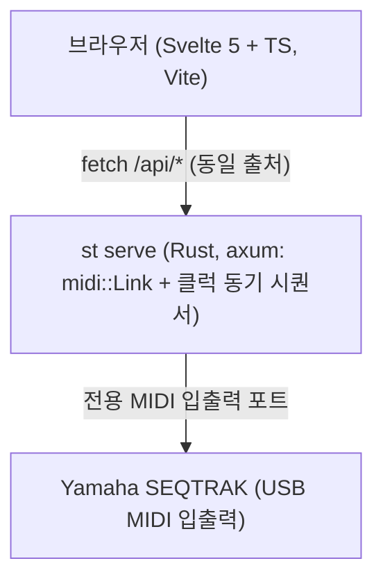

# 웹 GUI 아키텍처 계획 (GUI Plan)

[English](GUI_PLAN.md) | 한국어

상태: 프로토타입. 두 가지 뷰(`DEVICE`, `MIXER`), 장비 MIDI 클럭에 동기화되는 백엔드 스텝 시퀀서, 그리고 영/한(`EN` / `KO`) 전환을 지원하는 인앱 매뉴얼을 제공합니다. 현재 프로토타입 단계이므로 일부 조작이나 상태 동기화가 정확히 동작하지 않을 수 있습니다.

## 아키텍처

`st serve`는 장비가 연결되지 않은 상태에서도 시작되며, 2초 간격으로 연결을 재시도합니다. 케이블 재연결 후 macOS CoreMIDI 클라이언트가 멈추면 `MIDIRestart`를 호출해 복구합니다. CoreMIDI는 다중 클라이언트를 허용하므로 `st serve`를 띄워 둔 상태에서도 터미널에서 `st` CLI 명령을 동시에 실행할 수 있습니다.

## 백엔드 HTTP API

| 경로 | 요청 본문 / 쿼리 | 동작 |
|---|---|---|
| `GET /api/health` | | `{ok, link, outputs, inputs}` 반환 |
| `GET /api/identity` | | Universal Identity 응답(`{version, raw}`) 조회 |
| `POST /api/note` | `{track, note, vel, dur}` | 단발 노트 발음(홀드 대기 중 뮤텍스 락 해제) |
| `POST /api/cc` | `{track, cc, val}` | CC 이름 또는 번호로 컨트롤 체인지 전송 |
| `POST /api/pc` | `{track, msb, lsb, prog}` | 뱅크 셀렉트(MSB/LSB) 및 프로그램 체인지 전송 |
| `POST /api/load` | `{project}` (1-8) | 프로젝트 1-8 로드 |
| `POST /api/transport` | `{action: "start" \| "stop"}` | 시퀀서 재생 또는 정지 |
| `POST /api/param` | `{addr, bytes}` | SysEx 파라미터 변경 전송 |
| `GET /api/param?addr=` | `addr=hh:mm:ll` | SysEx 파라미터 단건 조회 |
| `POST /api/snapshot` | `{project, seconds}` | 프로젝트 로드 시 쏟아지는 파라미터 에코 스트림 캡처 |
| `POST /api/monitor` | `{seconds, clock}` | 수신 MIDI 이벤트 캡처 |
| `GET /api/seq` | | `{playing, rec, step, patterns: 11x32}` 반환 |
| `POST /api/seq` | `{op: "step" \| "rec" \| "clear" \| "note", ...}` | GUI 스텝 레이어 조작, REC 토글, 실시간 노트 입력 |

`/api/seq`는 GUI 전용 스텝 레이어를 제어합니다. 백엔드의 클럭 리더 스레드가 장비에서 오는 96 PPQ `0xF8` 스트림(16분음표당 6클럭)을 읽어 전용 출력 연결로 노트를 쏘며, 장비 내부의 패턴 메모리는 변경하지 않습니다.

## 화면 구성

- **DEVICE**: 하드웨어 상판(유저 가이드 패널 항목 1-27)을 그대로 재현한 SVG 화면입니다. 측면 버튼, `[ALL]` 및 트랙 노브(실제 SysEx 패턴 선택 1-6), 재생 헤드가 표시되는 2x8 드럼 스텝 그리드, `[REC]` 및 7개 스케일 키, 사운드 디자인 노브, `[FX]` 타입 노브, 고정식 `MASTER/SINGLE` 스위치, 순간 작동식 `HIGH PASS` 및 `REPEATER` 터치 슬라이더를 포함합니다.
- **MIXER**: 11개 트랙 스트립(볼륨, 팬, 뮤트, 솔로, 청음), 7개 드럼 패드, 아르페지오 블록, `ALL` 마스터 볼륨 노브, 트랜스포트, 프로젝트 버튼(`P1`-`P8`), 수신 MIDI 이벤트 로그로 구성됩니다.
- **HELP**: 상단 바에서 여는 인앱 매뉴얼(`HelpPanel.svelte`)로, 패널 안에서 `EN` / `KO` 언어를 즉시 전환할 수 있습니다.

## 프론트엔드 구성

- `gui/`: 별도 UI 프레임워크 없이 Vite, Svelte 5(`$state`, `$derived`, `$props` 룬), TypeScript로 작성되었습니다.
- 스텝 그리드는 낙관적 업데이트와 `pending` 집합 가드를 사용해 120ms 주기의 `/api/seq` 폴링 응답이 방금 클릭한 셀 상태를 덮어쓰지 않도록 보호합니다.

## 브라우저 E2E 검증 (`browser-harness`)

1. `st serve &` 실행 후 브라우저에서 `http://127.0.0.1:8787`에 접속합니다.
2. SVG 키와 노브에 합성 `PointerEvent`(`pointerdown` 및 `pointerup`)를 보내고 `/api/seq`, `/api/param`, `/api/health`로 상태 변경을 확인합니다.
3. 재생 검증은 `st monitor`를 통해 장비가 에코하는 시퀀서 노트를 확인합니다.

## 배포 체크리스트

- `cd gui && npm run check && npm run build` 실행
- `cargo test && cargo clippy --all-targets -- -D warnings && cargo build --release` 실행
- `cargo install --path . --locked`로 로컬 바이너리 갱신
