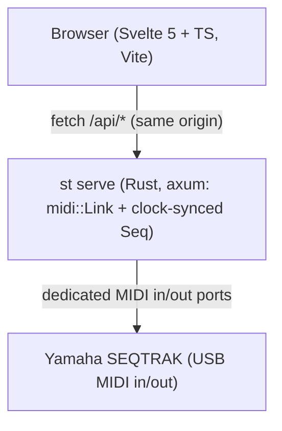

# GUI Architecture Plan

English | [한국어](GUI_PLAN.ko.md)

Status: Prototype. Two views (`DEVICE` and `MIXER`), backend step sequencer synced to the unit's MIDI clock, and a bilingual (`EN` / `KO`) in-app manual. Because the GUI is still in prototype status, some controls or hardware states may not work accurately yet.

## Architecture

`st serve` starts even when the SEQTRAK is disconnected, retries the MIDI connection every 2 seconds, and calls `MIDIRestart` on macOS if a CoreMIDI client gets stuck after replugging. Multiple CoreMIDI clients can run in parallel, so `st` CLI commands work while `st serve` is running.

## HTTP API surface

| Route | Request body / query | Effect |
|---|---|---|
| `GET /api/health` | | `{ok, link, outputs, inputs}` |
| `GET /api/identity` | | `{version, raw}` from Universal Identity Reply |
| `POST /api/note` | `{track, note, vel, dur}` | Triggers a single note (unlocks mutex during hold) |
| `POST /api/cc` | `{track, cc, val}` | Sends a Control Change by name or number |
| `POST /api/pc` | `{track, msb, lsb, prog}` | Sends Bank Select MSB/LSB and Program Change |
| `POST /api/load` | `{project}` (1 to 8) | Loads a project on the unit |
| `POST /api/transport` | `{action: "start" \| "stop"}` | Starts or stops the sequencer |
| `POST /api/param` | `{addr, bytes}` | Sends a SysEx Parameter Change |
| `GET /api/param?addr=` | `addr=hh:mm:ll` | Reads a single parameter via SysEx Parameter Request |
| `POST /api/snapshot` | `{project, seconds}` | Captures the project load parameter echo stream |
| `POST /api/monitor` | `{seconds, clock}` | Captures incoming MIDI events |
| `GET /api/seq` | | `{playing, rec, step, patterns: 11x32}` |
| `POST /api/seq` | `{op: "step" \| "rec" \| "clear" \| "note", ...}` | Controls the GUI step layer, REC state, and live note input |

`/api/seq` drives the GUI step layer: the backend clock thread reads the unit's 96 PPQ `0xF8` stream (6 ticks per 16th note) and sends step notes over a dedicated output connection without modifying the unit's internal pattern memory.

## Views

- **DEVICE**: Hardware-faithful SVG faceplate (User Guide panel items 1 to 27) with side buttons, `[ALL]` and per-track pattern knobs (SysEx `30:5p:0F`), 2x8 drum step grid with live playhead, `[REC]` plus 7 scale keys, Sound Design knobs, `[FX]` type knob, latching `MASTER/SINGLE` switch, and momentary `HIGH PASS` and `REPEATER` touch strips.
- **MIXER**: 11 track strips (volume, pan, mute, solo, audition hit), 7 drum trigger pads, arpeggiator block, master `ALL` volume knob, transport controls, project loader (`P1` to `P8`), and incoming MIDI log.
- **HELP**: In-app manual drawer (`HelpPanel.svelte`) with an `EN` / `KO` language toggle.

## Frontend stack

- `gui/`: Vite, Svelte 5 (`$state`, `$derived`, `$props` runes), and TypeScript with zero external UI component libraries.
- Optimistic step toggling with a `pending` set guard so 120 ms `/api/seq` polling never clobbers in-flight clicks.

## Browser E2E verification (`browser-harness`)

1. Run `st serve &` and open `http://127.0.0.1:8787`.
2. Dispatch synthetic `PointerEvent` (`pointerdown` and `pointerup`) on SVG keys and knobs, then inspect `/api/seq`, `/api/param`, and `/api/health`.
3. Verify note output with `st monitor`: the unit echoes notes fired by the step sequencer.

## Release checklist

- Run `cd gui && npm run check && npm run build`.
- Run `cargo test && cargo clippy --all-targets -- -D warnings && cargo build --release`.
- Reinstall local binaries with `cargo install --path . --locked`.
