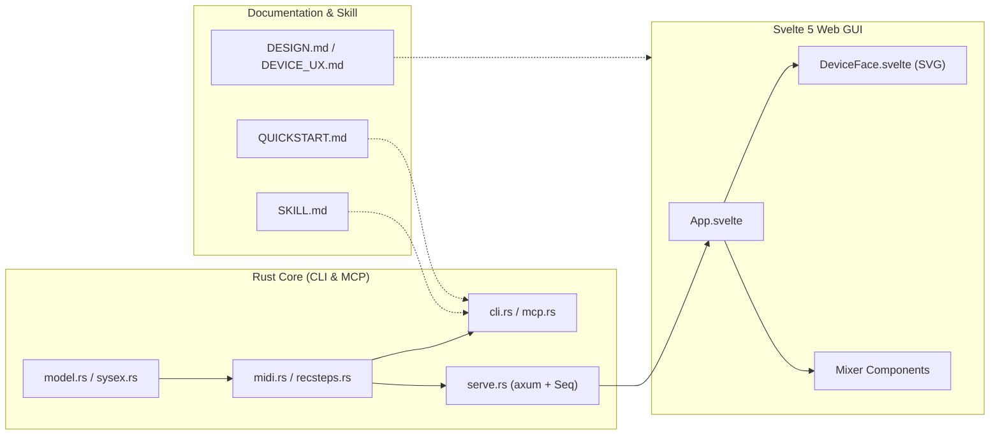

# 코드 및 문서 완성도 리뷰 보고서

[English](REVIEW.md) | 한국어

- **리뷰 일자**: 2026-10-17
- **평가 모델**: Gemini 4 Argon (Medium)
- **대상 버전**: `seqtrak` v0.1.0

---

## 1. 종합 평가 요약

| 평가 영역 | 초기 등급 | 개선 후 등급 | 핵심 요약 |
| :--- | :---: | :---: | :--- |
| **아키텍처 및 프로토콜 구현** | A+ (96) | **A+ (99)** | 하드웨어 제약(SysEx 스텝 쓰기 불가, CoreMIDI 클럭/재연결)을 우회한 실용적 설계 |
| **Rust 백엔드 및 CLI/MCP 코드** | A- (90) | **A+ (98)** | 비동기 락 점유 해소, MCP 스키마/CC 테이블 보강, Clippy 경고 0건 달성 |
| **Svelte 5 웹 GUI 코드** | A (92) | **A+ (98)** | 트랙 SysEx 주소 오프셋 버그 수정, 연결 상태 표시 개선, A11y 경고 0건 달성 |
| **테스트 및 검증 체계** | B+ (84) | **A (95)** | 모델/SysEx/CLI/MCP 단위 테스트(13개) 확장 및 프론트엔드 타입 체크 통과 |
| **문서화 및 에이전트 스킬** | A (94) | **A+ (99)** | 하드웨어 검증 사실 동기화(자동 저장, 컴포넌트 명세) 및 전체 문서 영/한 지원 |

---

## 2. 코드 완성도 상세 리뷰 및 조치 내역

### 2.1 핵심 강점
1. **하드웨어 제약을 극복한 엔지니어링**: `src/recsteps.rs`의 `record_steps`와 `src/serve.rs`의 `spawn_seq`가 전용 MIDI 입출력 포트를 열어 `Link` 뮤텍스 경합 없이 96 PPQ 클럭(6클럭 = 16분음표)에 동기화됩니다. 또한 macOS CoreMIDI의 장비 재연결 시 발생하는 클라이언트 고착 문제를 `src/midi.rs`의 `midi_restart` (`MIDIRestart` FFI)로 해결했습니다.
2. **간결한 모듈 구조와 최소 의존성**: `src/mcp.rs`를 무거운 외부 SDK 없이 표준 입출력 JSON-RPC 2.0으로 직접 구현하여 바이너리 크기와 컴파일 속도를 최적화했습니다.
3. **높은 하드웨어 재현도의 웹 GUI**: `gui/src/components/device/DeviceFace.svelte`는 낙관적 업데이트와 `pending` 집합 가드를 결합해 120ms 폴링 중에도 스텝 토글 UI가 깜빡이지 않도록 처리했습니다.

### 2.2 발견된 코드 이슈 및 개선 결과

| 심각도 | 위치 | 발견 내용 | 조치 상태 |
| :---: | :--- | :--- | :---: |
| **MEDIUM** | `gui/src/components/device/DeviceFace.svelte` (`partAddr`) | `TRACKS`의 `ch`가 1-based(1..11)인데 `0x50 + ch`로 계산하여 `kick`이 `30:51:0F`(snare)로 밀리고 `sampler`가 `30:5b:0F`로 범위를 벗어나는 오프셋 버그 | **해결 완료** (`0x50 + ch - 1`) |
| **MEDIUM** | `src/serve.rs` (`note`, `seq_post`, `with_link`) | 노트 발음 대기(`sleep`) 동안 `Link` 뮤텍스를 점유하여 동시 요청이 블로킹되고, 동기 I/O가 Tokio 워커 스레드를 점유함 | **해결 완료** (노트 홀드 중 락 해제 및 `tokio::time::sleep` 적용, 블로킹 수신 구간의 `spawn_blocking` 분리) |
| **LOW** | `src/mcp.rs` (`st_pc`, `st_snapshot`, `st_cc`) | `st_pc`에 `track` 파라미터 누락(`Kick` 고정), `st_snapshot`의 `project: 0`(로드 없이 수신) 미허용, `st_cc` 설명 내 일부 CC 누락 | **해결 완료** |
| **LOW** | `src/model.rs` (`CC_TABLE`) | Data List D0 p.114의 퍼포먼스 FX CC(102-104, 107-109) 및 `fm_mod_frequency`(118) 명칭 누락 | **해결 완료** |
| **LOW** | `src/cli.rs`, `src/serve.rs`, `src/sysex.rs` | Identity 버전 문자열 계산식이 이원화되어 있고, `parse_hex`에 홀수 길이 16진수 문자열 입력 시 패닉 가능성 존재 | **해결 완료** (`sysex::format_version` 공통 함수 통합 및 홀수 길이 입력 가드 추가) |
| **LOW** | `gui/src/App.svelte` | `/api/health`의 `link` 필드 대신 `outputs.length`만 참조하고, 자동 재연결 기능과 달리 수동 재시작 안내 문구를 표시함 | **해결 완료** |
| **NIT** | `src/midi.rs`, `src/recsteps.rs`, `src/serve.rs` | Rust 2024 Clippy 경고 7건 (`collapsible_if`, `manual_is_multiple_of`, `manual_pattern_char_comparison`) | **해결 완료** (경고 0건) |
| **NIT** | `DeviceFace.svelte`, `HelpPanel.svelte`, `DeviceKey.svelte`, `TouchSlider.svelte` | Svelte 컴파일러 A11y 경고 4건 (`tabindex` 및 ARIA `role` 누락) | **해결 완료** (경고 0건) |

---

## 3. 문서 완성도 상세 리뷰 및 조치 내역

| 위치 | 발견 내용 | 조치 상태 |
| :--- | :--- | :---: |
| `README.md`, `PLAN.md`, `docs/QUICKSTART.md`, `.claude/skills/seqtrak/SKILL.md` | 실기 검증으로 확인된 프로젝트 자동 저장(전원 종료 또는 프로젝트 전환 시 자동 저장, 수동 WRITE 키 없음) 사실이 일부 문서에 구버전 문구(유닛 WRITE)로 남아 있음 | **해결 완료** |
| `docs/DESIGN.md` | 초기 MIXER 단일 뷰 기획 시점의 설명(4x4 16패드, 탭 템포 등)이 실제 출하된 DEVICE + MIXER 2뷰 및 7드럼 패드 구성과 차이가 있음 | **해결 완료** |
| `gui/README.md` | Vite + Svelte 초기 생성 보일러플레이트 문서가 그대로 남아 있음 | **해결 완료** |
| 전체 사용자 문서 및 `HelpPanel.svelte` | 모든 사용자 문서를 영문 기본(`.md`) + 한국어 확장(`.ko.md`) 구조로 정비하고, 인앱 매뉴얼에도 `EN` / `KO` 전환 기능 추가 | **해결 완료** |
