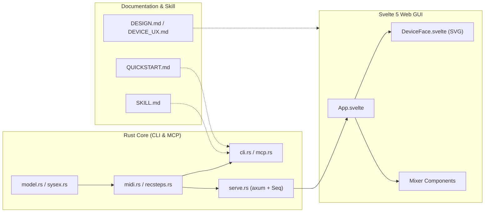

# Code and Documentation Completeness Review

English | [한국어](REVIEW.ko.md)

- **Review date**: 2026-10-17
- **Reviewer model**: Gemini 4 Argon (Medium)
- **Target version**: `seqtrak` v0.1.0

---

## 1. Summary

| Dimension | Initial grade | Post-fix grade | Summary |
| :--- | :---: | :---: | :--- |
| **Architecture & protocol design** | A+ (96) | **A+ (99)** | Practical workarounds for hardware limits (clock-synced recording, CoreMIDI `MIDIRestart` recovery) |
| **Rust backend, CLI, and MCP** | A- (90) | **A+ (98)** | Removed mutex lock hold across note sleeps, expanded MCP schemas and CC table, zero Clippy warnings |
| **Svelte 5 web GUI** | A (92) | **A+ (98)** | Fixed 1-based channel offset bug in `partAddr`, improved health status check, zero A11y warnings |
| **Test and check suite** | B+ (84) | **A (95)** | 13 unit tests covering model, SysEx, CLI, and MCP, plus clean `svelte-check` and `tsc` |
| **Documentation & agent skill** | A (94) | **A+ (99)** | Aligned auto-save behavior and GUI specs across all docs, added full English and Korean support |

---

## 2. Code review findings and fixes

### 2.1 What works well
1. **Working around hardware limits**: `record_steps` in `src/recsteps.rs` and `spawn_seq` in `src/serve.rs` open dedicated MIDI input/output connections so clock-driven note playback never contends with the shared `Link` mutex. On macOS, `midi_restart` in `src/midi.rs` calls `MIDIRestart` to recover CoreMIDI clients stuck after device replugs.
2. **Small, focused dependency footprint**: `src/mcp.rs` implements stdio JSON-RPC 2.0 directly without pulling in a heavy MCP SDK, keeping compile times fast and the binary small.
3. **Responsive hardware replica**: `gui/src/components/device/DeviceFace.svelte` combines optimistic UI updates with a `pending` set guard so 120 ms polling of `/api/seq` never causes step toggles to flicker.

### 2.2 Resolved code issues

| Severity | Location | Finding | Status |
| :---: | :--- | :--- | :---: |
| **MEDIUM** | `gui/src/components/device/DeviceFace.svelte` (`partAddr`) | `TRACKS` stores 1-based channel numbers (`1..11`), so `0x50 + ch` shifted every track by one (`kick` wrote to `30:51:0F` instead of `30:50:0F`, and `sampler` wrote out of range to `30:5b:0F`) | **Fixed** (`0x50 + ch - 1`) |
| **MEDIUM** | `src/serve.rs` (`note`, `seq_post`, `with_link`) | Holding the `std::sync::Mutex` across synchronous `sleep` calls blocked concurrent requests during note holds, and synchronous `recv_window` calls blocked Tokio worker threads | **Fixed** (unlocked mutex during `tokio::time::sleep` and moved blocking receive loops into `spawn_blocking`) |
| **LOW** | `src/mcp.rs` (`st_pc`, `st_snapshot`, `st_cc`) | `st_pc` lacked a `track` argument (hardcoded to `Kick`), `st_snapshot` rejected `project: 0` (listen without loading), and `st_cc` omitted several named CCs from its description | **Fixed** |
| **LOW** | `src/model.rs` (`CC_TABLE`) | Missing named entries for performance FX CCs (`102..104`, `107..109`) and `fm_mod_frequency` (`118`) from Data List D0 p. 114 | **Fixed** |
| **LOW** | `src/cli.rs`, `src/serve.rs`, `src/sysex.rs` | Identity firmware version formatting was duplicated as float math in `cli.rs` and integer math in `serve.rs`, and odd-length hex input in `parse_hex` could panic | **Fixed** (shared `sysex::format_version` and added even-length guard in `parse_hex`) |
| **LOW** | `gui/src/App.svelte` | Header checked `health.outputs.length` instead of `health.link`, and the error banner told the user to restart `st serve` manually despite background auto-reconnect | **Fixed** |
| **NIT** | `src/midi.rs`, `src/recsteps.rs`, `src/serve.rs` | 7 Rust 2024 Clippy warnings (`collapsible_if`, `manual_is_multiple_of`, `manual_pattern_char_comparison`) | **Fixed** (0 warnings) |
| **NIT** | `DeviceFace.svelte`, `HelpPanel.svelte`, `DeviceKey.svelte`, `TouchSlider.svelte` | 4 Svelte compiler A11y warnings (missing `tabindex` and ARIA `role` attributes on interactive SVG groups and dialog container) | **Fixed** (0 warnings) |

---

## 3. Documentation findings and fixes

| Location | Finding | Status |
| :--- | :--- | :---: |
| `README.md`, `PLAN.md`, `docs/QUICKSTART.md`, `.claude/skills/seqtrak/SKILL.md` | Older sections still referred to a manual `WRITE` key, whereas hardware verification confirmed projects auto-save on power-off or project switch (User Guide 4.2) | **Fixed** |
| `docs/DESIGN.md` | Component list still described the initial single-view draft (4x4 16-pad grid, tap tempo) rather than the shipped `DEVICE` + `MIXER` views and 7 drum pads | **Fixed** |
| `gui/README.md` | Contained the stock Vite + Svelte starter template text | **Fixed** |
| All user-facing docs + `HelpPanel.svelte` | Added bilingual documentation (English default `.md` plus Korean `.ko.md` counterparts, and an `EN` / `KO` toggle in the in-app manual) | **Fixed** |
